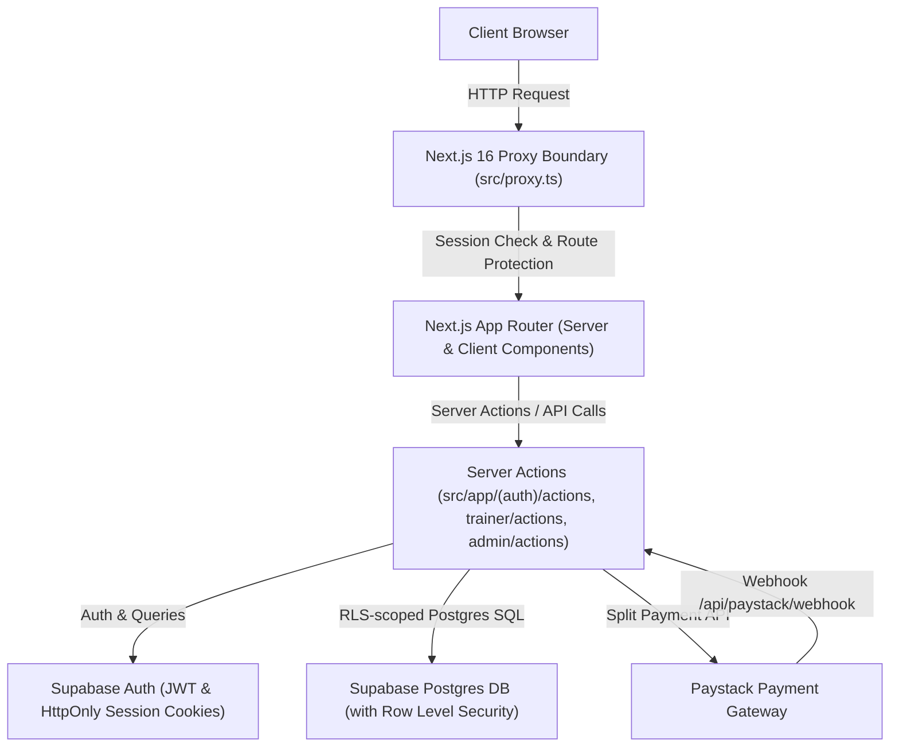
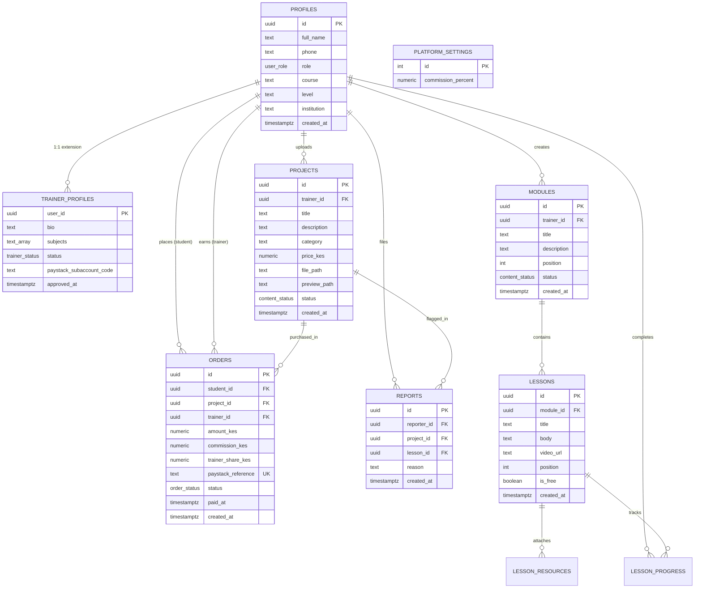

# BrightPath — Master Project Context & Architecture

**Document Version:** 1.1.0
**Last Updated:** 2026-10-31
**Platform Status:** Operational / In Active Development  

---

## 1. Executive Summary & Application Purpose

**BrightPath** is a full-stack educational and digital products platform built for students, academic trainers, and institutional administrators in East Africa (pricing in Kenyan Shillings — KES, payment processing via Paystack).

### Core Value Propositions:
1. **For Students:**
   - Access verified, ready-made academic projects, source code packages, diagrams, and business plans.
   - Follow guided revision modules and curriculum lessons (notes, video lectures, and attached downloadable resources).
   - Maintain a personal digital library of purchased projects with secure download links.
   - Build KNEC project drafts with structured sections, evidence-based review, and supervisor feedback.
2. **For Trainers:**
   - Author and publish structured revision curricula (modules broken down into lessons).
   - Upload ready-made project packages for sale on the marketplace.
   - Automated revenue split via Paystack subaccounts upon project purchase.
3. **For Administrators:**
   - Full platform governance, user management, and moderation queue for projects and trainer applications.
   - Real-time KPI analytics (sales volume, commission revenue, active learners).
   - Configurable platform commission rate (deducted automatically on each purchase).
   - Content moderation and report resolution.

---

## 2. Technology Stack

| Layer | Technologies & Versions |
|---|---|
| **Framework** | Next.js 16.4.3 (App Router, Turbopack, Partial Prerendering / Cache Components) |
| **Language & Runtime** | TypeScript 5, Node.js v24.13.0 |
| **UI & Styling** | React 19.3.0, Tailwind CSS v4 (`@tailwindcss/turbopack`), Lucide React icons |
| **Database & Auth** | Supabase (PostgreSQL 15+, Row Level Security, Supabase Auth SSR `@supabase/ssr` 0.12.7, `@supabase/supabase-js` 2.118.0) |
| **Payment Gateway** | Paystack (Split payments, Webhook verification, Transaction initialization) |
| **Edge / Middleware** | Next.js 16 `src/proxy.ts` (modern replacement for deprecated `middleware.ts`) |

---

## 3. Architecture & Routing Structure

### Route Map

| Route | Purpose | Access Control | Status |
|---|---|---|---|
| `/` | Landing page highlighting value pillars & CTAs | Public (Auth-aware header) | Verified |
| `/login` | User authentication (email/password with confirmed-email detection) | Public (redirects if logged in) | Verified |
| `/signup` | User registration (captures Full Name, email, password) | Public | Verified |
| `/projects` | Public marketplace of ready-made projects and business plans | Public | Verified |
| `/learn` | Student curriculum directory with modules and lessons | Public / Students | Verified |
| `/library` | Personal library of purchased projects and download access | Authenticated (`/proxy.ts`) | Verified |
| `/studio` | Candidate Project Studio and workspace list | Authenticated students | Verified |
| `/studio/[id]` | Guided KNEC proposal, chapter drafting, and project review | Workspace owner | Verified |
| `/supervisor/[workspaceId]` | Continuous candidate document, moderation, and supervisor review | Assigned supervisor or admin | Verified |
| `/trainer` | Trainer Studio for uploading projects, modules, and bulk import | Authenticated (`trainer` or `admin`) | Verified |
| `/admin` | Administration hub: KPIs, commission settings, moderation, user roles | Authenticated (`admin` only) | Verified |
| `/api/paystack/initialize` | Creates Paystack transaction with trainer split code | Authenticated Students | Verified |
| `/api/paystack/webhook` | Receives Paystack payment success & marks order paid | Server (HMAC verified) | Verified |
| `/api/download` | Delivers signed URL for project download if paid order exists | Authenticated Student / Owner / Admin | Verified |

### Project Studio and Business Plan Workflow

Business plans follow the required structure, voice, evidence, and formatting rules in [`BUSINESS_PLAN_CONTENT_STANDARD.md`](BUSINESS_PLAN_CONTENT_STANDARD.md).

- `src/lib/studio/templates/business.ts` defines KNEC sections, guidance, and minimum word expectations.
- `src/lib/studio/businessPlanBuilder.ts` generates the complete structured draft, including itemized steps, lists, and tables.
- `src/lib/studio/businessPlanMath.ts` is the deterministic source for financial calculations and statements.
- `src/lib/studio/businessPlanGeneration.ts` uses the selected Gemini or Groq provider for limited fact corrections and whole-document audit findings. AI review cannot silently rewrite financial calculations or the full manuscript.
- Students keep section-level review and can run a separate whole-document audit. Assigned supervisors and administrators can review the complete business plan and follow findings to the relevant chapter.
- Normal builds preserve saved text. Replacing existing content requires the explicit confirmed rebuild action.

---

## 4. Database Entities & Relationships

---

## 5. Security & Authentication Architecture

1. **Authentication:**
   - Powered by Supabase Auth with server-side cookie sessions (`@supabase/ssr`).
   - Sessions are validated on the server via `proxy.ts` on protected paths (`/learn`, `/library`, `/trainer`, `/admin`).
   - Granular error diagnostics distinguish between unconfirmed email states and bad passwords.
2. **Authorization & RBAC:**
   - Supported Roles: `student`, `trainer`, `supervisor`, `admin`.
   - Admin access is verified server-side (`is_admin()` SQL function and `profiles.role === 'admin'`).
   - RLS strictly forbids users from elevating their own `role` in `profiles`.
3. **Secret Protection:**
   - `SUPABASE_SERVICE_ROLE_KEY` is strictly confined to server-side scripts (`scripts/make-admin.mjs`) and backend API handlers (`src/lib/supabase/admin.ts`).
   - Never prefixed with `NEXT_PUBLIC_` and never included in client bundles.
4. **Next.js 16 Route Segment Configuration:**
   - Dynamic routes accessing cookies/runtime data utilize `export const instant = false;` to be fully compatible with Next.js 16 Partial Prerendering (`cacheComponents: true`).

---

## 6. Technical Debt & Outstanding Work

1. **Purchases & Checkout Flow:**
   - Implement `api/paystack/initialize/route.ts` to generate Paystack checkout URLs with subaccount split.
   - Implement `api/paystack/webhook/route.ts` to verify cryptographic HMAC signatures and update `orders.status = 'paid'`.
2. **Student Library & Project Download:**
   - Complete `src/app/library/page.tsx` showing purchased projects and lesson progress.
   - Implement `src/app/api/download/route.ts` with signed URLs from Supabase private storage.
3. **UI/UX Consistency & Design System:**
   - Standardize UI tokens, buttons, inputs, modal dialogs, and tables across all views.
   - Fix all ESLint type and entity formatting issues (`no-explicit-any`, unescaped JSX quotes).
